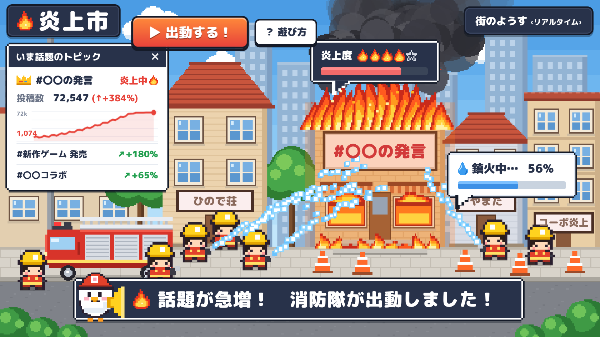

# 炎上市（えんじょうし）

遊びながら、デマの延焼を防ぎ、みんなの情報リテラシーを育てる社会貢献型Webゲーム。

ドット絵の街で次々と「炎上」する話題（デマ・誤情報）を、消防士になって鎮火しよう。

## 遊び方

`index.html` をブラウザで開くだけで遊べます（ビルド不要）。GitHub Pages などの静的ホスティングでもそのまま動きます。

| 機能 | 内容 |
| --- | --- |
| 消火アクション | 消防士を操作して放水。仲間の消防士と協力して火を消す |
| 火元調査ミッション | 燃えている建物の看板をタップ（E キー）。話題の主張を「事実・推測・不明」に分類すると炎が一気に弱まる |
| 延焼防止・予防活動 | 「！」のくすぶりの前でパトロールして炎上を未然に防ぐ。防火壁（F キー）で隣への延焼をブロック |
| 防火訓練クイズ | 出動の合間にクイズ。正解すると防火壁がもらえる |
| 結果画面 | 街の統計・3つの力（調べる力／見分ける力／考える力）・プレイ後のアクション提案 |

### 操作

- 移動：`←→↑↓` / `WASD`
- 放水：マウス長押しでねらって放水、`Space` で近くの火に自動放水
- `E` 火元調査 / `F` 防火壁 / `P` 一時停止
- スマホ：建物を長押しで放水、道路をタップで移動（横向き推奨）

## ファイル構成

- `index.html` — 画面とHUD
- `css/style.css` — ドット枠・吹き出し・パネルなどのUIデザイン
- `js/pixel.js` — ドット絵（街・建物・消防士・消防車・マスコット・アイコン）の描画
- `js/data.js` — デマの話題（火元調査）と防火訓練クイズのデータ
- `js/game.js` — ゲーム本体

話題やクイズは `js/data.js` を編集すれば追加できます。登場する人物・団体・出来事はすべて架空です。
